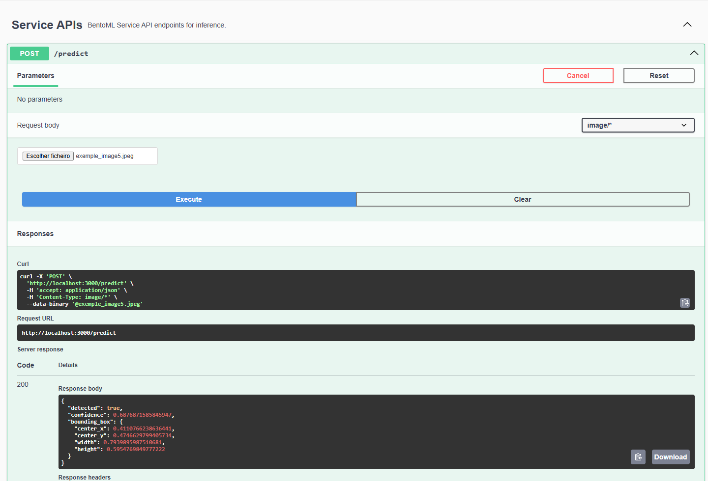
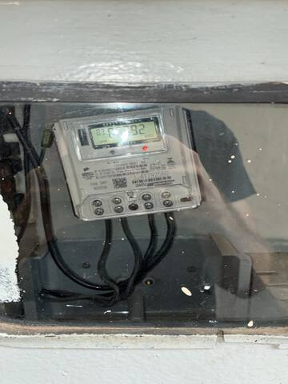
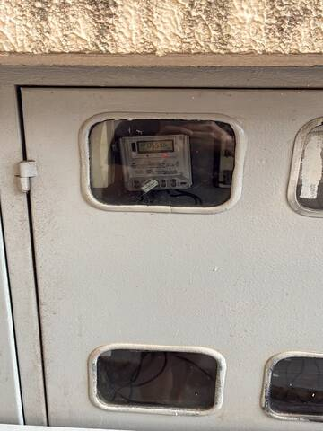
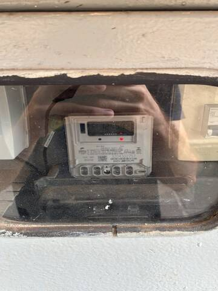
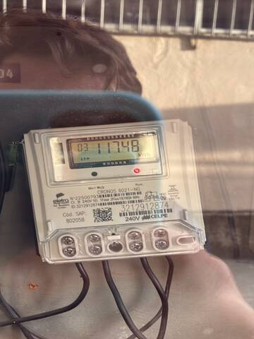

# VoltLens AI

API de inferência para detecção de medidores de energia elétrica em imagens, desenvolvida como parte da disciplina de MLOps.

O projeto transforma um modelo de visão computacional previamente treinado em um serviço HTTP utilizando **BentoML**, permitindo que outras aplicações enviem uma imagem e recebam como resposta a detecção do medidor, sua localização na imagem e a confiança da predição.

## Sumário

- [Objetivo](#objetivo)
- [Modelo utilizado](#modelo-utilizado)
- [Limitações atuais](#limitações-atuais)
- [Arquitetura do serviço](#arquitetura-do-serviço)
- [Execução](#execução)
- [Utilização da API](#utilização-da-api)
- [Contrato da API](#contrato-da-api)
- [Monitoramento das inferências](#monitoramento-das-inferências)
- [Teste de carga e comportamento](#teste-de-carga-e-comportamento)
- [Análise dos logs](#análise-dos-logs)
- [Retenção dos logs](#retenção-dos-logs)
- [Demonstração](#demonstração)
- [Possíveis evoluções](#possíveis-evoluções)
- [Uso de Inteligência Artificial](#uso-de-inteligência-artificial)
- [Licença](#licença)

---

## Objetivo

O objetivo é disponibilizar o modelo de detecção de medidores como um serviço consumível por outras aplicações, retirando a inferência do ambiente de desenvolvimento e tornando-a acessível por meio de uma API HTTP.

O fluxo da aplicação é:

```text
Imagem
   ↓
API BentoML
   ↓
Pré-processamento
   ↓
MeterNetwork
   ↓
Inferência
   ↓
JSON
```

O serviço recebe uma imagem através do endpoint `/predict` e retorna a indicação de detecção, a confiança e a bounding box normalizada.

---

## Modelo utilizado

O modelo é uma rede neural convolucional desenvolvida especificamente para a detecção de medidores em imagens. A arquitetura `MeterNetwork` foi implementada em **PyTorch**, com camadas convolucionais, ativações ReLU e operações de Max Pooling.

### Entrada

A imagem recebida pela API passa pelo seguinte pré-processamento:

1. Conversão para RGB;
2. Redimensionamento para `360 × 480`;
3. Conversão para escala de cinza;
4. Conversão para tensor;
5. Envio para o modelo.

### Saída

O modelo produz um grid de predições contendo posição `x`, posição `y`, largura, altura e confiança/objectness. A melhor predição é selecionada e convertida para coordenadas normalizadas.

### Treinamento

O modelo foi desenvolvido e treinado anteriormente como parte do projeto de visão computacional da disciplina, utilizando imagens rotuladas com bounding boxes da classe `Medidor`.

O checkpoint utilizado pela API é:

```text
model/meter_detector.pt
```

O serviço não realiza treinamento. Sua responsabilidade é carregar o modelo e disponibilizar a inferência por meio de uma API.

### Características do modelo

- **Framework:** PyTorch
- **Tipo:** Rede Neural Convolucional
- **Tarefa:** detecção/localização de medidor
- **Classe detectada:** `Medidor`
- **Entrada:** imagem
- **Tamanho utilizado pelo modelo:** `360 × 480`
- **Saída:** bounding box + confiança

---

## Limitações atuais

O modelo atualmente realiza **detecção do medidor**. Ele ainda não realiza:

- OCR do número do medidor;
- Leitura do consumo;
- Identificação automática de todas as funções do equipamento;
- Comparação entre a leitura da imagem e uma leitura de referência;
- Classificação de divergência.

A qualidade da detecção pode variar de acordo com iluminação, posição da câmera, distância, enquadramento, oclusões, qualidade da imagem e características do medidor não representadas adequadamente no conjunto de treinamento.

Por esse motivo, o modelo não deve ser considerado um sistema completo de leitura automática de medidores. Nesta versão, seu objetivo é exclusivamente localizar o medidor na imagem.

---

## Arquitetura do serviço

O serviço foi desenvolvido utilizando **BentoML**, com o modelo executado localmente e disponibilizado através de uma API HTTP.

```text
voltlensAI/
├── model/
│   └── meter_detector.pt
├── images/
│   ├── exemple_image1.jpeg
│   ├── exemple_image2.jpeg
│   ├── exemple_image3.jpeg
│   ├── exemple_image4.jpeg
│   └── exemple_image5.jpeg
├── assets/
│   └── swagger.png
├── documents/
│   └── VoltLens Analysis.xlsx
├── logs/
│   └── inference.log              # Gerado durante a execução
├── notebooks/
│   └── voltlensai_log_analysis.ipynb
├── utils/
│   └── load_test.py
├── src/
│   └── voltlensai/
│       ├── __init__.py
│       ├── model.py
│       ├── inference.py
│       ├── monitoring.py
│       ├── middleware.py
│       └── service.py
├── pyproject.toml
├── uv.lock
├── .python-version
├── .gitignore
├── LICENSE
└── README.md
```

### Responsabilidade dos arquivos

| Arquivo | Responsabilidade |
| --- | --- |
| `model.py` | Define a arquitetura da rede neural `MeterNetwork`. |
| `inference.py` | Carrega o checkpoint, realiza o pré-processamento, executa a inferência e interpreta a saída. |
| `service.py` | Expõe o modelo como uma API utilizando BentoML e integra o fluxo de inferência ao monitoramento. |
| `monitoring.py` | Registra eventos estruturados em JSON Lines, incluindo identificador da requisição, timestamp, latência, status HTTP, metadados da entrada, saída e erro. |
| `middleware.py` | Acompanha as requisições ao endpoint `/predict`, captura o status HTTP e registra falhas. |
| `model/meter_detector.pt` | Checkpoint com os pesos treinados. |
| `images/` | Imagens públicas para demonstração e testes. |
| `assets/swagger.png` | Captura da interface Swagger/OpenAPI. |
| `utils/load_test.py` | Executa uma sequência de requisições com imagens originais, variações de brilho/contraste e payloads inválidos. |
| `notebooks/voltlensai_log_analysis.ipynb` | Analisa os registros, gera estatísticas e visualizações de latência, confiança, volume e erros. |
| `pyproject.toml` | Define dependências e configurações. |
| `uv.lock` | Registra versões resolvidas das dependências. |

---

## Execução

### Requisitos

- Git;
- Python na versão especificada em `.python-version`;
- [`uv`](https://docs.astral.sh/uv/).

> O projeto foi desenvolvido e testado em ambiente Windows.

### 1. Clonar o projeto

```bash
git clone https://github.com/FelipeSalustiano/voltlensAI.git
cd voltlensAI
```

### 2. Instalar as dependências

O projeto utiliza `uv` para gerenciamento do ambiente e das dependências.

```bash
uv sync
```

O arquivo `uv.lock` está versionado para garantir uma instalação reproduzível. A instalação pode levar alguns minutos, principalmente devido às dependências de PyTorch e torchvision.

### 3. Iniciar o serviço

```bash
uv run bentoml serve src/voltlensai/service.py:MeterDetectionService
```

Após a inicialização, o serviço estará disponível em:

```text
http://localhost:3000
```

---

## Utilização da API

### Swagger / OpenAPI

Com o servidor em execução, acesse `http://localhost:3000`, localize o endpoint `POST /predict`, clique em **Try it out**, selecione uma imagem JPEG e execute a requisição.



### Testando via cURL

No PowerShell:

```powershell
curl.exe -X POST http://localhost:3000/predict `
  -H "Content-Type: image/jpeg" `
  --data-binary "@images/exemple_image1.jpeg"
```

O comando envia a imagem diretamente no corpo da requisição.

---

## Contrato da API

### Endpoint

```text
POST /predict
```

### Entrada

A API recebe uma imagem diretamente no corpo da requisição, com `Content-Type: image/jpeg`.

### Saída

Quando um medidor é detectado:

```json
{
  "detected": true,
  "confidence": 0.67,
  "bounding_box": {
    "center_x": 0.81,
    "center_y": 0.22,
    "width": 0.75,
    "height": 0.57
  }
}
```

Quando nenhum objeto é detectado acima do limiar utilizado pelo serviço:

```json
{
  "detected": false,
  "confidence": 0.0,
  "bounding_box": null
}
```

| Campo | Descrição |
| --- | --- |
| `detected` | Indica se um medidor foi detectado |
| `confidence` | Confiança da detecção |
| `center_x` | Coordenada X central normalizada |
| `center_y` | Coordenada Y central normalizada |
| `width` | Largura da bounding box normalizada |
| `height` | Altura da bounding box normalizada |

As coordenadas da bounding box são normalizadas entre `0` e `1`, representando a localização do objeto relativamente às dimensões da imagem.

### Exemplo de resposta real

Em um teste realizado localmente, a API retornou:

```json
{
  "detected": true,
  "confidence": 0.6720746159553528,
  "bounding_box": {
    "center_x": 0.8110498487949371,
    "center_y": 0.22479363481203715,
    "width": 0.7532642483711243,
    "height": 0.5677396059036255
  }
}
```

---

## Monitoramento das inferências

O projeto implementa mecanismos de monitoramento para acompanhar o comportamento do serviço durante sua execução. O monitoramento contempla registros persistentes em arquivo e métricas de runtime disponibilizadas pelo BentoML.

### Logs estruturados

As informações das requisições são registradas em:

```text
logs/inference.log
```

O arquivo é criado automaticamente durante a execução do serviço, caso o diretório ainda não exista. Os registros são armazenados no formato **JSON Lines (JSONL)**: cada linha representa um evento independente em formato JSON.

Exemplo ilustrativo (formatado em várias linhas para leitura; no arquivo, cada evento ocupa uma única linha):

```json
{
  "timestamp": "2026-11-12T13:30:00.123456+00:00",
  "request_id": "uuid-da-requisicao",
  "endpoint": "/predict",
  "input": {
    "width": 640,
    "height": 480,
    "format": "JPEG",
    "pixel_mean": 112.5,
    "pixel_std": 48.2
  },
  "output": {
    "detected": true,
    "confidence": 0.67,
    "bounding_box": {
      "center_x": 0.81,
      "center_y": 0.22,
      "width": 0.75,
      "height": 0.57
    }
  },
  "latency_ms": 44.46,
  "status_code": 200,
  "error": null
}
```

Campos registrados:

| Campo | Descrição |
| --- | --- |
| `timestamp` | Data e hora do evento em UTC |
| `request_id` | Identificador único da requisição |
| `endpoint` | Endpoint acessado |
| `input` | Metadados da imagem recebida |
| `output` | Resultado da inferência, quando disponível |
| `latency_ms` | Latência registrada em milissegundos |
| `status_code` | Status HTTP da requisição |
| `error` | Descrição do erro, quando existente |

O middleware registra falhas e entradas inválidas, permitindo acompanhar requisições que não concluíram a inferência com sucesso.

> **Observação sobre latência:** no caminho de sucesso, a latência é medida no fluxo de inferência. Para falhas capturadas pelo middleware, a medição considera o tempo observado no processamento da requisição ASGI. Os dois tipos de latência possuem escopos de medição diferentes e não devem ser combinados sem essa ressalva.

### Métricas Prometheus

O BentoML disponibiliza métricas de runtime no endpoint:

```text
http://localhost:3000/metrics
```

Entre as métricas expostas estão:

| Métrica | Tipo | Descrição |
| --- | --- | --- |
| `bentoml_service_request_total` | Counter | Total de requisições processadas |
| `bentoml_service_last_request_timestamp_seconds` | Gauge | Timestamp da última requisição |
| `bentoml_service_request_in_progress` | Gauge | Requisições em processamento |
| `bentoml_service_request_duration_seconds` | Histogram | Distribuição da duração das requisições |

O histograma também disponibiliza séries auxiliares, como `_bucket`, `_sum` e `_count`, que permitem analisar a distribuição e calcular estatísticas agregadas de latência.

**Diferença entre logs e métricas:** os logs mantêm eventos individuais em arquivo, enquanto as métricas do BentoML representam agregações do processo em execução. Os contadores do Prometheus são reiniciados quando o serviço é reiniciado; o arquivo de log permanece em modo append, salvo remoção ou alteração manual.

---

## Teste de carga e comportamento

O script `utils/load_test.py` executa uma sequência de requisições para observar o comportamento da API.

O cenário implementado utiliza:

- 70 requisições com imagens originais;
- 20 requisições com variações de brilho e contraste;
- 10 requisições com payloads inválidos.

Mantenha o serviço em execução em um terminal e, em outro, execute:

```bash
uv run python utils/load_test.py
```

Esse cenário realiza requisições sequenciais. Portanto, trata-se de um teste funcional com volume de requisições, não de um teste de estresse concorrente.

---

## Análise dos logs

O notebook `notebooks/voltlensai_log_analysis.ipynb` realiza a leitura dos registros JSONL e utiliza pandas para explorar os dados gerados pelo serviço.

A análise contempla:

- volume de requisições;
- distribuição de status HTTP;
- taxa de erro;
- latência das inferências;
- distribuição de confiança das detecções;
- características das imagens recebidas;
- evolução temporal das requisições;
- identificação de eventos com erro.

Também são geradas visualizações, como histogramas e boxplots de latência, além de tabelas e arquivos CSV exportados para apoiar a análise.

Para iniciar o Jupyter no ambiente do projeto:

```bash
uv run jupyter notebook
```

Em seguida, abra `notebooks/voltlensai_log_analysis.ipynb`.

> A análise depende da existência do arquivo `logs/inference.log`, gerado após a execução do serviço e o envio de requisições.

---

## Retenção dos logs

Atualmente, os registros são gravados em `logs/inference.log` utilizando um `FileHandler` em modo append. Novas linhas são adicionadas ao arquivo existente.

A implementação atual não configura rotação automática, limite de tamanho ou prazo de expiração dos registros.

Para um ambiente de produção, recomenda-se definir uma política de retenção, considerando:

- rotação dos arquivos por tamanho ou período;
- limite de armazenamento;
- prazo de retenção definido conforme requisitos operacionais;
- arquivamento ou descarte dos registros antigos;
- controle de acesso aos arquivos de log.

Essas medidas são recomendações de evolução e não funcionalidades de retenção automática já implementadas nesta versão.

---

## Demonstração

O repositório disponibiliza cinco imagens públicas para demonstração e teste da API.

### Imagem 1



### Imagem 2



### Imagem 3


### Imagem 4



### Imagem 5



As imagens podem ser utilizadas diretamente nos exemplos de requisição deste README. São destinadas exclusivamente à demonstração do serviço e não devem conter dados de clientes ou informações operacionais privadas.

---

## Possíveis evoluções

Como próximos passos, o serviço pode evoluir para um pipeline mais completo de leitura de medidores:

```text
Imagem
   ↓
Detecção do medidor
   ↓
Recorte da região
   ↓
OCR
   ↓
Leitura dos valores
   ↓
Validação com dados de referência
   ↓
Classificação
```

Entre as possíveis melhorias estão:

- implementação de OCR;
- identificação do número do medidor;
- leitura do consumo;
- tratamento de diferentes condições de iluminação;
- aumento e diversificação do dataset;
- avaliação com métricas específicas de detecção;
- ajuste do limiar de confiança;
- monitoramento das inferências;
- versionamento dos modelos;
- criação de testes automatizados;
- acompanhamento de métricas de desempenho do modelo em produção.

---

## Uso de Inteligência Artificial

Ferramentas de Inteligência Artificial generativa foram utilizadas como apoio durante o desenvolvimento, principalmente para:

- auxílio na estruturação do serviço;
- esclarecimento de conceitos e APIs;
- revisão de código;
- identificação e correção de problemas de integração;
- apoio na elaboração da documentação.

As sugestões geradas foram analisadas e adaptadas ao projeto. Todo o código utilizado foi revisado e validado durante a execução local do serviço. A utilização de IA não substituiu a compreensão e validação do funcionamento do código.

---

## Licença

Este projeto está disponibilizado sob a licença MIT.

Consulte o arquivo [`LICENSE`](LICENSE) para mais informações.
